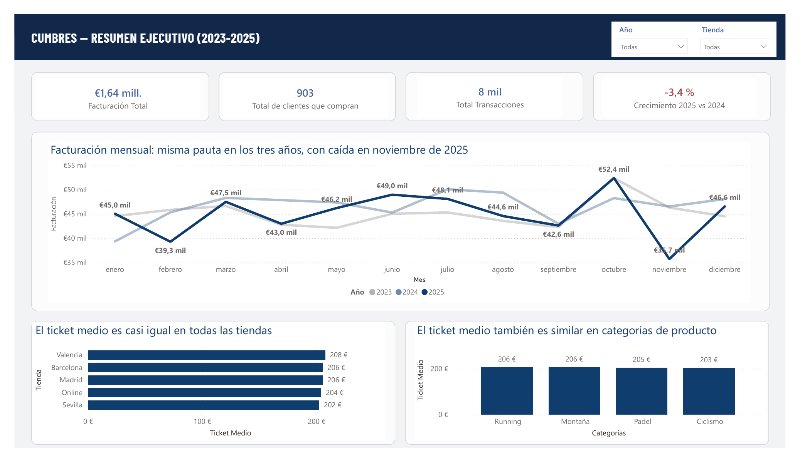
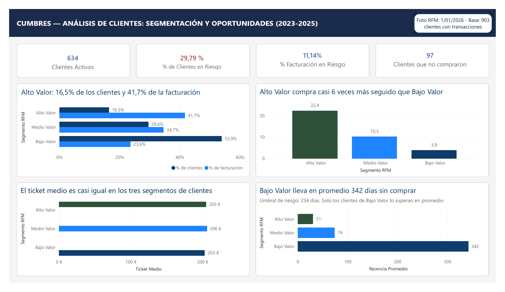
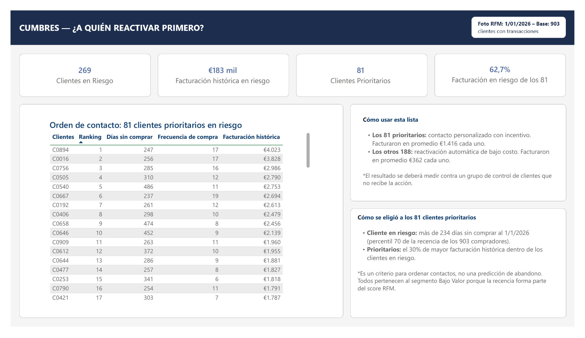
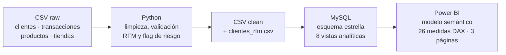

# Cumbres Outdoor & Deportes · Customer Analytics

Análisis de clientes de una cadena de retail deportivo con cuatro tiendas físicas y un canal online, construido de punta a punta con **Python → MySQL → Power BI**.

El proyecto responde a una pregunta de negocio concreta: **cómo se distribuye el valor de la cartera y a qué clientes inactivos conviene contactar primero**. Es un análisis descriptivo, con una foto de la cartera al **1/1/2026** construida a partir del historial 2023-2025.

> **Los datos son sintéticos.** Cumbres Outdoor & Deportes es una empresa ficticia. El dataset (1.000 clientes, 8.000 transacciones, 5 puntos de venta, 2023-2025) se generó en Python con errores de calidad introducidos a propósito para trabajar la limpieza.

---

## Dashboard

**1. Resumen ejecutivo.** Facturación, compradores, transacciones y evolución mensual, con filtros de año y tienda.



**2. Análisis de clientes.** Segmentación RFM: peso de cada segmento en clientes y en facturación, frecuencia, ticket y recencia.



**3. ¿A quién reactivar primero?** Los 269 clientes en riesgo ordenados por facturación histórica, con los 81 prioritarios.



---

## Hallazgos clave

| | Cifra | Lectura |
|---|---|---|
| Facturación 2023-2025 | €1.640.308 | 903 de los 1.000 clientes registrados compraron al menos una vez. 2025 cierra un 3,4% por debajo de 2024 porque compraron menos clientes (751 → 730), no por precio ni frecuencia. |
| Concentración del valor | 16,5% → 41,7% | Los 149 clientes de Alto Valor generan el 41,7% de la facturación. |
| Qué explica el valor | 22,4 vs 3,9 compras | Alto Valor compra casi 6 veces más seguido que Bajo Valor, con un ticket casi igual en los tres segmentos (~€205). La diferencia es de frecuencia, no de gasto por compra. |
| Clientes en riesgo | 269 (29,79%) | Más de 234 días sin comprar al 1/1/2026. Son muchos clientes pero poco valor: el 11,14% de la facturación histórica (€182.755). |
| Priorización | 81 clientes → 62,7% | El 30% de los clientes en riesgo con mayor facturación histórica concentra €114.670, el 62,7% del valor en riesgo. Una campaña dirigida a 81 clientes cubre casi dos tercios de ese valor. |
| Registros sin compra | 97 (9,7%) | Clientes captados que nunca compraron. Oportunidad de ciclo corto pero acotada (del orden de €6.600 si convirtiera un tercio). |

Los 81 clientes prioritarios pertenecen todos al segmento **Bajo Valor**, y no por casualidad: la recencia entra tanto en el score RFM como en el umbral de riesgo, así que un cliente inactivo cae en Bajo Valor aunque haya comprado mucho en el pasado. Es una consecuencia del diseño, no un hallazgo (informe técnico, apartado 5.5).

---

## Limitaciones

- **"En riesgo" es un criterio de priorización, no una predicción.** El umbral de 234 días es el percentil 70 de la recencia de los 903 compradores. No hay modelo de abandono ni validación del umbral: el dataset no registra bajas, así que el indicador mide inactividad elevada, no abandono.
- **La facturación en riesgo es histórica.** Los €182.755 y €114.670 son lo que esos clientes compraron en 2023-2025, no lo que se puede recuperar.
- **Foto estática.** La segmentación RFM se calcula una vez al 1/1/2026 y no muestra cómo se mueven los clientes entre segmentos.
- **Datos sintéticos.** Algunas regularidades, como el ticket casi idéntico entre segmentos y tiendas, vienen del generador. Las conclusiones tendrían que revalidarse con datos reales.
- **Sin costos ni márgenes.** Las cifras dimensionan oportunidades sobre facturación, no su rentabilidad.
- **Decisiones de limpieza con efecto en los resultados.** Las 240 transacciones sin punto de venta se imputaron al canal online, y eso explica buena parte de su liderazgo en facturación.

El detalle de cada limitación está en el capítulo 9 del informe técnico.

---

## Arquitectura



Cada herramienta tiene un rol definido:

- **Python** concentra la calidad del dato y la lógica de negocio: limpieza, segmentación RFM por quintiles y el umbral de riesgo. Se calculan una sola vez.
- **MySQL** guarda los datos certificados en un esquema estrella y expone 8 vistas para explotar los datos en SQL. No recalcula la segmentación.
- **Power BI** importa el esquema estrella y agrega con DAX sin redefinir la clasificación. Cada medida está reconciliada contra MySQL (anexo B del informe).

---

## Estructura del repositorio

```
Customer_analytics/
├── data/
│   ├── raw/                  # CSV originales generados (sin modificar)
│   └── clean/                # CSV limpios + clientes_rfm.csv
├── python/notebooks/
│   ├── 01_generacion_dataset.ipynb
│   ├── 02_limpieza_eda.ipynb
│   └── 03_construccion_rfm.ipynb
├── sql/
│   ├── customer_analytics.sql                              # esquema, carga y controles
│   ├── views_customer_analytics.sql                        # 8 vistas analíticas
│   ├── customer_analytics_reconciliacion_mysql_powerbi.sql # reconciliación con Power BI
│   └── customer_analytics_tienda-cliente.sql               # consultas exploratorias cliente-tienda
├── power_bi/
│   └── customer_analytics.pbix
├── tmdl_export/              # modelo semántico en TMDL (medidas DAX legibles)
├── documentos/
│   ├── Informe_técnico_customer_analytics.pdf  # decisiones, validaciones y anexos
│   └── Informe_negocio.pdf   # decisiones para dirección (4 páginas)
├── assets/                   # capturas y PDF del dashboard, diagramas
└── requirements.txt
```

---

## Cómo reproducirlo

**Requisitos:** Python 3.11+, MySQL 9.x, MySQL Connector/ODBC y Power BI Desktop (Windows).

1. **Python**
   ```bash
   pip install -r requirements.txt
   ```
   Ejecutá los notebooks en orden. `01` regenera el dataset sintético y es opcional, porque `data/raw/` ya está incluido. `02` limpia los datos y `03` construye `clientes_rfm.csv`.

2. **MySQL**
   - Copiá los CSV de `data/clean/` a la carpeta habilitada por `secure_file_priv` (por defecto `C:/ProgramData/MySQL/MySQL Server 9.4/Uploads/`).
   - Ejecutá en este orden:
     1. `sql/customer_analytics.sql`: crea la base `customer_analytics`, carga los datos y corre los controles.
     2. `sql/views_customer_analytics.sql`
     3. `sql/customer_analytics_reconciliacion_mysql_powerbi.sql` (opcional): compara cada indicador con el valor esperado.

3. **Power BI**
   - Creá un origen ODBC de usuario llamado `mysql_powerbi` que apunte a la base `customer_analytics`.
   - Abrí `power_bi/customer_analytics.pbix` y hacé clic en **Actualizar**.

Si solo querés leer las medidas DAX sin abrir Power BI, están en `tmdl_export/tables/Medidas.tmdl`.

---

## Documentación

El **informe técnico** (`documentos/Informe_técnico_customer_analytics.pdf`) recoge el razonamiento detrás de cada decisión: diagnóstico de calidad del dato, construcción del RFM y del umbral, modelo relacional, reconciliación MySQL–Power BI, hallazgos, recomendaciones y limitaciones.

El **informe de negocio** (`documentos/Informe_negocio.pdf`) está pensado para dirección comercial: qué decisiones permite tomar el análisis, con qué datos contamos, qué datos faltan y en qué seguir trabajando.

---

## Autora

**Martina Cottura**: analista de datos (Python · SQL · Power BI), licenciada en Sociología.
[GitHub](https://github.com/martina-cottura)
